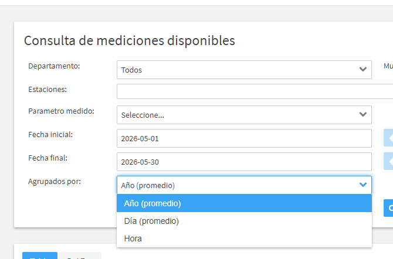

En la carpeta `backend/anexos/datos/crudos/` encuentras los siguientes archivos:

archivos csv: fuente de datos de salud desde 2008 a 2017, no encontramos datos actuales.
Solo los datos de https://sisaire.ideam.gov.co/ideam-sisaire-web/consultas.xhtml
donde pondemos obtener datos del pm2.5 por departamento y municipio del valle de aburra por año y dia promedio o tambien por hora.
sisaire.png: imagen de referencia de la fuente de datos
 

Tenemos tambien conexion con el api dE SIATA en el proyecto C:\Users\ASUS\Documents\mariana\itm_mariana\Integracion y adquisición de datos\proyecto\integracion_datos_sia en api_sia_actual.py que saca los datos en tiempo real del PM 2.5 del valle de aburra.

Estoy en un proyecto de integracion y adquisicion de datos y el contexto de todo el prouyecto, objetivos y titulo esta en documentacion_idea_proyecto.docx.

titulo: Integrar datos de sensores PurpleAir y estaciones SIATA para evaluar impactos de la calidad del aire en la salud pública

Objetivo: 
Integrar las mediciones de material particulado PM2.5 de la red SIATA y sensores ciudadanos PurpleAir, utilizando Python para la normalización de frecuencias y la mitigación del sesgo por humedad o aire. El sistema deberá asegurar la continuidad del flujo de información mediante protocolos de imputación de datos, permitiendo la automatización del índice de riesgo local durante el primer trimestre de 2026​

 
calidad_aire.png: es la infografia de el proyecto.

Equipo
3 estudiantes 2 semestre de ciencia de datos en la materia integracion y adquisicion de datos. El equipo esta conformado por mi que se programar y algo de arquitectura de datos, tengo experiencia con etl y pipelines de datos, porque tengo experiencia en el area analitica.
tambien hay 2 personas que no tienen experiencia.
Tiempo para hacerlo: 3 dias.

Tu tarea es hacer un plan de implementacion del proyecto
y concluir cual seria el entregable y porque es innovador a lo que ya existe.
usemos procesos de etl, que si lleven carga de datos.
Aun no sabemos modelado avanzado de datos, solo la parte de integracion y adquidsicion de datos

Esto es lo que me dijo notebooklm con el contexto dado que te puede servir de contexto, si se te ocurren mejores ideas eres libre de proponer:

Desarrollar un pipeline de datos que integre mediciones en tiempo real de estaciones SIATA y sensores PurpleAir para traducir niveles de PM2.5 en indicadores de incremento de riesgo de salud (respiratorio y cardiovascular) y dosis inhalada, basándose en modelos históricos (2008-2017) y variables meteorológicas.

--------------------------------------------------------------------------------
2. Arquitectura de Datos Recomendada (PostgreSQL)
Para este proyecto, recomiendo PostgreSQL.
Por qué: Sus datos de salud históricos son relacionales (CSVs con columnas fijas)
. PostgreSQL permite realizar "Joins" complejos entre el municipio del sensor y su coeficiente de riesgo (beta) de manera eficiente
. Además, cuenta con extensiones espaciales (PostGIS) si a futuro desean mapear los riesgos por coordenadas exactas de SIATA y PurpleAir
.

--------------------------------------------------------------------------------
3. Distribución Equitativa de Tareas (Células de Trabajo)
Para que el proyecto sea equitativo y aproveche que solo uno sabe programar avanzado, dividiremos el equipo en tres roles:
A. El Integrador (Tú - Programación Avanzada):
Adquisición: Crear los scripts en Python para conectarse al API de SIATA (XML) y PurpleAir (JSON)
.
Modelado de Calidad: Implementar el algoritmo de Random Forest o Regresión Lineal para la imputación de datos faltantes y la calibración de los sensores PurpleAir usando las estaciones SIATA (BAM-1020) como referencia
.
Base de Datos: Diseñar el esquema de las tablas en PostgreSQL.
B. El Analista de ETL (Compañeros - Aprendizaje de Python):
Limpieza de Datos: Aprenderán a usar la librería Pandas para limpiar los CSVs históricos (2008-2017) y prepararlos para la carga
.
Normalización: Implementar scripts sencillos en Python para convertir las diferentes frecuencias de muestreo (2 min de PurpleAir vs 1 hora de SIATA) a una escala común
.
Carga: Usar Python para insertar los datos limpios en las tablas de PostgreSQL.
C. El Especialista en Contexto y Salud (Compañeros - Diseño y Lógica):
Cálculo de Fórmulas: Investigar y aplicar las fórmulas de Dosis Diaria Inhalada (ADD) y los coeficientes beta de su CSV para que el programador solo tenga que codificar la lógica
.
Validación de Métricas: Calcular manualmente y documentar las métricas de desempeño (R2, RMSE, Sesgo) para validar que el sistema es preciso
.
Diseño del Dashboard: Definir qué alertas predictivas mostrar (ej. alertas de "Efecto Diferido" o por "Perfil de Usuario") y cómo visualizarlas
.

--------------------------------------------------------------------------------
4. Innovaciones Tecnológicas y Analíticas
Para que el proyecto destaque, incluiremos estos tres elementos:
Mitigación de Sesgo por Humedad en Tiempo Real: El sistema no solo leerá PM2.5; usará los datos de humedad de SIATA para aplicar una ecuación de corrección a los sensores PurpleAir (ya que la alta humedad confunde el láser con partículas)
.
Cálculo de "Dosis Inhalada" (ADD) Dinámica: El tablero permitirá al usuario elegir su actividad (ej. reposo vs ciclismo) y calculará cuántos microgramos de PM2.5 está inhalando realmente basándose en su peso y tasa de ventilación
.
Alerta de Riesgo Diferido (LAG): Innovación de avisar que, debido a la contaminación detectada hoy, el riesgo de incremento en consultas médicas subirá en los próximos 1 a 9 días, permitiendo una alerta preventiva real
.

--------------------------------------------------------------------------------
5. Metodología de Implementación (CRISP-DM)
Seguirán las fases recomendadas por las fuentes para proyectos de ciencia de datos
:
Comprensión: Definir qué grupo de edad del CSV histórico es el más vulnerable
.
Preparación: Unificar formatos XML, JSON y CSV en PostgreSQL
.
Modelado: Aplicar los coeficientes de riesgo históricos a las mediciones actuales
.
Evaluación: Comparar un sensor PurpleAir con la estación SIATA más cercana para verificar la precisión del ajuste
.
6. Entregables Finales
Base de Datos PostgreSQL: Con datos integrados y limpios.
Dashboard (en Streamlit o PowerBI): Visualización de PM2.5 calibrado, dosis inhalada y semáforo de riesgo epidemiológico basado en los datos de 2008-2017
.
