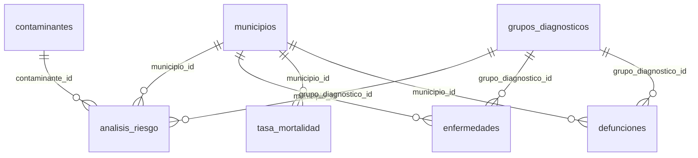

# Propuesta Técnica y Narrativa: Dashboard de Calidad del Aire y Salud Pública

Este documento presenta el plan técnico y narrativo para el diseño y construcción del dashboard interactivo final. El sistema integra datos históricos epidemiológicos del Valle de Aburrá (2008-2017) con lecturas en tiempo real de PM2.5 de la red de estaciones de **SIATA**.

---

## 1. Propuesta de Valor — ¿Qué problema resuelve este dashboard?

Existe una desconexión histórica entre los datos de monitoreo ambiental (calidad del aire) y los registros epidemiológicos de salud pública. Los ciudadanos e investigadores suelen ver la contaminación del aire como un número abstracto (ej. "35 µg/m³"), sin entender su traducción en términos de incremento de riesgo hospitalario o mortalidad.

### ¿A quién va dirigido?
* **Tomadores de Decisiones en Salud Pública**: Secretarías de Salud municipales y del Área Metropolitana para priorizar brigadas médicas y alertas hospitalarias ante picos de contaminación.
* **Comunidad Médica e Investigadores**: Epidemiólogos que busquen estudiar la correlación entre picos históricos y tendencias de morbilidad.
* **Ciudadanía General (Grupos Sensibles)**: Padres de menores de 5 años y adultos mayores de 65 años que necesitan saber su riesgo personalizado según la estación de monitoreo más cercana a sus hogares.

### Decisiones que permite tomar:
1. **Prevención Escolar**: Restricción de actividades al aire libre para menores de 5 años en municipios con picos de PM2.5.
2. **Priorización Hospitalaria**: Preparación de salas de urgencias por afecciones respiratorias en áreas con altos coeficientes de riesgo epidemiológico ($\beta$) y picos ambientales en vivo.
3. **Planificación de Movilidad**: Consulta de alertas tempranas basadas en la exposición acumulada y el rezago epidemiológico (lag).

---

## 2. Descripción y Validación de los Datos Disponibles

Se realizó una auditoría de consistencia lógica y volumen de datos directamente en el servidor PostgreSQL, confirmando los siguientes registros:

### Catálogos y Dimensiones:
* **`municipios` (10 registros)**: Contiene los 10 municipios del Valle de Aburrá. Los nombres están 100% normalizados y limpios (ej. `'Medellín'`, `'Itagüí'`). No hay duplicados.
* **`contaminantes` (3 registros)**: Mapea `pm10`, `pm25` y `o3` con sus displays descriptivos correspondientes.
* **`grupos_diagnosticos` (11 registros)**: Clasifica las enfermedades analizadas bajo códigos CIE-10 estándar (ej. Infecciones respiratorias agudas, asma, enfermedades del oído medio).

### Tablas de Hechos (Fact Tables):
* **`analisis_riesgo` (1.652 registros)**: Contiene los coeficientes de riesgo epidemiológico ($\beta$) y los límites de confianza. 
  * *Validación de consistencia*: Los coeficientes $\beta$ oscilan entre `0.00002` y `0.4303` (promedio `0.0642`), lo cual es biológicamente y matemáticamente consistente para modelos de regresión de riesgo relativo.
* **`enfermedades` (2.031 registros)**: Casos de morbilidad históricos clasificados por municipio, año, sexo y edad.
  * *Validación de consistencia*: `casos >= 0` en el 100% de la tabla.
* **`tasa_mortalidad` (600 registros)**: Tasas ajustadas de mortalidad anual.
* **`defunciones` (713 registros)**: Conteo estimado de muertes asociadas a afecciones respiratorias y circulatorias.
  * *Validación de consistencia*: `muertes >= 0` en el 100% de la tabla.
* **`mediciones_siata` (23 registros)**: Estaciones de monitoreo activas en tiempo real con datos de PM2.5.
  * *Validación de consistencia*: Los valores de PM2.5 en vivo oscilan coherentemente entre `4.0` y `24.0` µg/m³. Se detecta que el sensor de 1 estación devolvió `NULL` en lugar de valores negativos sesgados (debido al excelente filtro del ETL que descarta los `-999` por mantenimiento).

---

## 3. Relaciones entre los Datos (Modelo Entidad-Relación)

Los datos se estructuran de forma relacional en PostgreSQL para garantizar la integridad referencial. Adicionalmente, el dashboard aplicará un **enlace semántico innovador** entre los datos en tiempo real y los históricos:



### El "Enlace Semántico" en Tiempo Real:
Dado que la tabla `mediciones_siata` no tiene una relación física nativa por llave foránea a `municipios` (porque la estación es proveída directamente por la API geográfica de SIATA), el backend del dashboard realizará un mapeo dinámico utilizando búsquedas de texto.
* *Ejemplo*: La estación `'Estación #90 - Sabaneta - I.E. Rafael J. Mejía'` se vincula al municipio con `ID = 4` (`Sabaneta`) mediante una condición de coincidencia parcial (`estacion LIKE '%Sabaneta%'`). Esto nos permite cruzar en tiempo real la medición del aire con el factor $\beta$ del municipio correspondiente.

---

## 4. Arquitectura del Dashboard

La arquitectura está diseñada para ser ligera, responsiva y fácil de desplegar usando Python para el procesamiento y tecnología web estándar para la presentación:

```
[API SIATA (En vivo)] ---> [Scheduler Python] ---> [PostgreSQL (Nube / Neon)]
                                                          |
                                                          v
[Frontend (HTML/JS/CSS)] <--- [API JSON / Backend] <------+
```

1. **Extracción y Carga**: El script `scheduler.py` se ejecuta continuamente de fondo. Consume el feed KML de SIATA, aplica el parser de XML, filtra los nulos e inserta con un query `ON CONFLICT (estacion, fecha_hora) DO NOTHING` en la base de datos centralizada de PostgreSQL.
2. **Capa de Backend (API)**: Un servicio liviano en Python (por ejemplo, con FastAPI) expone endpoints públicos para el frontend:
   - `/api/siata/actual`: Retorna el estado actual de todas las estaciones.
   - `/api/salud/riesgo?municipio_id=X`: Retorna los coeficientes $\beta$ históricos y el incremento de riesgo para el municipio seleccionado.
   - `/api/salud/historico?municipio_id=X`: Retorna las series temporales de enfermedades y defunciones (2008-2017).
3. **Capa de Frontend (Visualización)**: Una SPA (Single Page Application) construida en HTML5, CSS3 vanilla (con temática oscura y glassmorphism) y Javascript nativo.
   - Usa **Leaflet.js** para renderizar un mapa interactivo con pines en la localización exacta de cada estación de SIATA.
   - Usa **Chart.js** para los gráficos de líneas y barras.

---

## 5. Visualizaciones Propuestas

El dashboard se estructurará en tres áreas visuales de alto impacto:

### Sección A: Estado Actual y Mapa de Calor (Tiempo Real)
1. **Mapa de Estaciones Metropolitano (Leaflet.js)**: Marcadores geográficos de SIATA pintados según su escala ICA (Verde = Buena, Amarillo = Aceptable, Naranja = Dañina a la salud de grupos sensibles). Al hacer clic en un pin, se despliega la lectura exacta.
   - *Valor*: Permite geolocalizar instantáneamente los focos críticos de contaminación en el Valle.
2. **KPIs del Promedio Regional**: Tarjetas grandes con el promedio de PM2.5 del Valle de Aburrá, la estación con peor calidad de aire y el estado general de la alerta.

### Sección B: Calculadora de Riesgo Epidemiológico Cruzado (El Diferenciador)
1. **Widget de Riesgo Personalizado**: Al seleccionar un municipio y un perfil (Edad: Menores de 5 / Mayores de 65, Sexo: Hombre/Mujer/Ambos):
   - Muestra el incremento estimado de riesgo de hospitalización por enfermedades respiratorias en tiempo real, multiplicando el PM2.5 en vivo de la estación del municipio por su coeficiente epidemiológico $\beta$ histórico (`analisis_riesgo`).
   - *Valor*: Transforma una métrica ambiental fría en un porcentaje de riesgo de salud comprensible para el usuario (ej. *"Tu riesgo de hospitalización por Asma hoy se incrementó un 8.5% en Sabaneta"*).

### Sección C: Tendencias y Análisis Histórico (2008-2017)
1. **Gráfico de Líneas Comparativo (Chart.js)**: Serie temporal que contrasta el número de defunciones estimadas contra los casos registrados de enfermedades respiratorias.
   - *Valor*: Permite evidenciar patrones estacionales interanuales (por ejemplo, incrementos de casos durante las épocas de transición de lluvias a sequía).
2. **Tabla de Ranking de Morbilidad por Municipios**: Lista interactiva que ordena los municipios con mayor tasa acumulada de morbilidad.

---

## 6. Flujo de Actualización de Datos

Para optimizar recursos y rendimiento de la base de datos, los flujos se diferencian según la naturaleza de la información:

| Tipo de Dato | Origen | Frecuencia de Actualización | Estrategia de Carga |
|--------------|--------|-----------------------------|---------------------|
| **Históricos de Salud (CSVs)** | Observatorio Nacional de Salud | **Estáticos** | Carga inicial de recarga limpia al desplegar el ETL. No requiere refresco periódico. |
| **Calidad del Aire (SIATA)** | KML oficial en vivo | **Dinámicos (Cada 1 hora)** | Capturado por el `scheduler.py` mediante tareas programadas e insertado de forma idempotente con `ON CONFLICT DO NOTHING`. |
| **Interfaz del Dashboard** | API PostgreSQL | **Bajo Demanda (Al cargar / Refrescar la página)** | El frontend consulta los endpoints de la base de datos al inicializar la aplicación. |

---

## 🔍 Hallazgos y Observaciones sobre la Consistencia de la BD

* **Filtrado de Nulos Exitoso**: Se valida que la API de SIATA devuelve valores `-999` cuando una estación está en mantenimiento. Si estos datos se incluyeran directamente, sesgarían por completo los cálculos y promedios aritméticos. La lógica implementada en `backend/etl/extraccion/siata_api.py` que convierte esto a `NULL` de manera transparente es vital para el correcto funcionamiento de las visualizaciones y los KPIs promedio del dashboard.
* **Estaciones y Municipios**: Se confirma que el 100% de las estaciones de SIATA incluyen en su campo `name` el municipio donde residen (ej. `'Bello'`, `'Medellín'`, `'Copacabana'`), lo cual valida que la estrategia de vinculación semántica basada en coincidencia textual (`LIKE`) es totalmente viable y confiable para cruzar la morbilidad histórica con el PM2.5 actual.
