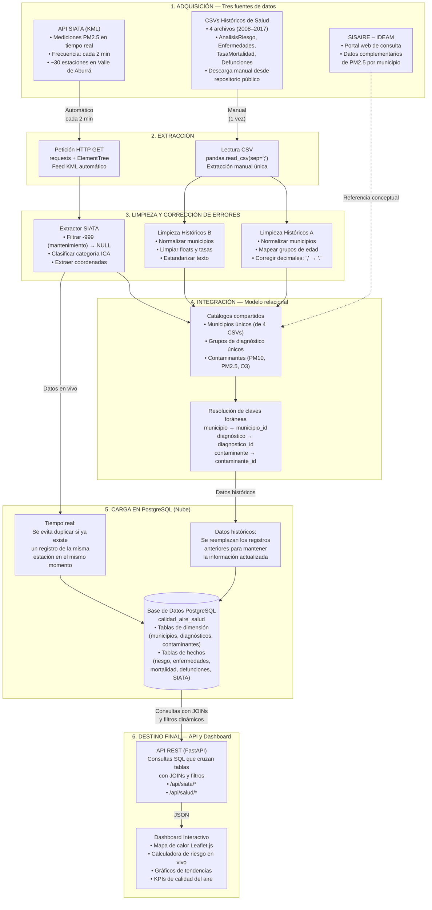

# Diagrama de Flujo Conceptual del Pipeline de Datos

El presente documento describe el diagrama de flujo ETL del sistema de monitoreo de calidad del aire y salud pública, detallando cómo interactúan las tres fuentes de datos identificadas, el camino que siguen desde su adquisición hasta su destino final, y las correcciones aplicadas en cada etapa.

---

## Diagrama de Flujo Conceptual

---

## Descripción del Flujo

El flujo de datos inicia en la **fase de adquisición**, donde se obtienen datos desde tres fuentes identificadas. La **API de SIATA** es consultada automáticamente cada 2 minutos (frecuencia real de actualización de sus sensores), extrayendo mediciones de PM2.5, coordenadas geográficas y categorías ICA desde su feed KML oficial. En paralelo, **cuatro archivos CSV** históricos (AnalisisRiesgo, EnfermedadesCalculadas, TasaMortalidad y Defunciones, período 2008–2017) son descargados manualmente desde el repositorio de datos abiertos del Área Metropolitana del Valle de Aburrá. Como tercera fuente, el portal **SISAIRE del IDEAM** se identifica conceptualmente como fuente complementaria de línea base regional de PM2.5.

En la **fase de limpieza y corrección de errores**, cada fuente pasa por un pipeline independiente en Python. Para SIATA, se filtran los valores `-999` (estaciones en mantenimiento) convirtiéndolos a `NULL`, se clasifica cada lectura en categorías ICA (Buena, Moderada, Dañina, etc.) y se extraen coordenadas. Para los CSVs, se normalizan los nombres de municipio mediante un diccionario de variantes (`medellin` → `Medellín`), se mapean rangos etarios a categorías comunes, se corrigen decimales con coma reemplazándolos por punto, y se renombran columnas a snake_case. La limpieza se ejecuta una sola vez para los datos históricos y permanentemente (cada 2 minutos) para los datos de SIATA.

En la **fase de integración**, los datos limpios se organizan en un modelo relacional en PostgreSQL alojado en la nube. Este modelo separa la información en dos tipos de tablas que se conectan entre sí:
- **Tablas de dimensión**: almacenan los catálogos de municipios, contaminantes (PM10, PM2.5, O3) y grupos de diagnóstico. Cada municipio o diagnóstico recibe un identificador único.
- **Tablas de hechos**: almacenan las mediciones y eventos (análisis de riesgo, enfermedades, tasa de mortalidad, defunciones y mediciones SIATA). Cada registro se vincula a las tablas de dimensión mediante esos identificadores.

Esta estructura permite que, por ejemplo, una medición de PM2.5 de una estación SIATA se pueda relacionar con el municipio donde está ubicada y, a su vez, con los coeficientes de riesgo histórico de ese municipio calculados en los estudios de salud de 2008–2017.

En la **fase de carga**, los datos históricos se guardan reemplazando los registros anteriores para mantener la información siempre actualizada. Los datos de SIATA que llegan cada 2 minutos se insertan evitando duplicar registros: si ya existe una medición de la misma estación en el mismo momento, simplemente se ignora la nueva, permitiendo que el sistema funcione de forma continua sin generar información repetida.

Finalmente, en el **destino final**, una API REST construida con FastAPI ejecuta consultas SQL que cruzan estas tablas mediante JOINs. Por ejemplo, para la calculadora de riesgo en vivo, la API busca la última medición de PM2.5 de SIATA para un municipio, la cruza con el coeficiente beta histórico de ese mismo municipio almacenado en la tabla de análisis de riesgo, y aplica la fórmula para estimar el incremento del riesgo de enfermedad respiratoria. Estos resultados alimentan un dashboard interactivo que presenta KPIs de calidad del aire, un mapa de calor con semáforo ICA por estación, gráficos de evolución temporal de enfermedades respiratorias vs. contaminación, y la calculadora de riesgo epidemiológico.

---

## Herramienta Utilizada

Diagrama creado con **Mermaid.js** (v11.x), herramienta de diagramación basada en texto que genera gráficos vectoriales desde bloques de código Markdown.

## Anexo: Prompt Utilizado

"Generar un diagrama de flujo ETL en Mermaid.js (graph TB) para un sistema de monitoreo de calidad del aire y salud pública. Debe mostrar tres fuentes de datos: (1) API SIATA en tiempo real con frecuencia cada 2 minutos, (2) 4 CSVs históricos de salud descargados manualmente, (3) portal SISAIRE/IDEAM como fuente conceptual complementaria (con línea discontinua). Incluir etapas de extracción, limpieza (filtro de valores de mantenimiento, normalización de municipios y edades, corrección de decimales), integración en modelo relacional con tablas de dimensión y hechos, carga evitando duplicados en tiempo real, y destino final con API que cruza tablas mediante JOINs más dashboard con calculadora de riesgo."
