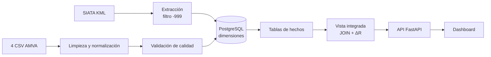

# Guía de explicación del código y su relación con la investigación

> **Para qué sirve este documento.** Explica cómo está organizado el código del
> proyecto, cómo debe explicarse cada módulo y cómo cada decisión técnica se
> conecta con el problema, el objetivo y el aporte de la investigación. Está
> pensado para la sustentación, para la revisión del docente y para que cualquier
> integrante del equipo pueda defender el trabajo sin depender de otro.


---

## 1. La idea en una frase

> **El código toma la contaminación del aire de hoy (SIATA), la ordena por
> municipio, la cruza con la sensibilidad histórica de la salud (β) y devuelve un
> riesgo epidemiológico local y personalizado.**

Todo lo demás —carpetas, funciones, tablas, scheduler— existe para que esa frase
sea reproducible, auditable y explicable.

---

## 2. Mapa mental del proyecto

```text
PROBLEMA                      PIPELINE (código)                RESULTADO
Datos ambientales      ─┐
fragmentados            │   Extracción → Transformación      Índice de Riesgo
y datos de salud        ├─→ → Integración → Carga      ────→  Local en tiempo
desactualizados        ─┘   (PostgreSQL)                    real + API + dashboard
```

La investigación no consiste en “tener datos”, sino en **demostrar que se pueden
integrar de forma consistente** y que esa integración produce un indicador útil
para la salud pública.

---

## 3. Estructura de carpetas (cómo está organizado el código)

```text
monitoreo_calidad_aire_para_salud/
├── README.md
├── guia_explicacion_codigo.md         # Este documento
└── backend/
    ├── etl/                           # Núcleo del pipeline (fases de la metodología)
    │   ├── __init__.py                # Mapa del paquete ETL
    │   ├── configuracion/             # Parámetros centralizados
    │   │   ├── settings.py            # BD, URL SIATA, rutas de CSV
    │   │   └── diccionarios.py        # Normalización de municipios y edades
    │   ├── extraccion/                # FASE 1: Extracción
    │   │   └── siata_api.py           # HTTP GET al KML de SIATA
    │   ├── transformacion/            # FASE 2: Limpieza y calidad
    │   │   ├── limpieza_riesgo.py
    │   │   ├── limpieza_enfermedades.py
    │   │   ├── limpieza_mortalidad.py
    │   │   ├── limpieza_defunciones.py
    │   │   └── calidad_datos.py
    │   ├── carga/                     # FASE 3: Integración y carga
    │   │   ├── conexion.py            # Conexión PostgreSQL
    │   │   ├── esquema.py             # DDL (dimensiones y hechos)
    │   │   ├── dimensiones.py         # Catálogos (municipios, CIE-10, contaminantes)
    │   │   ├── hechos.py              # Carga de históricos
    │   │   ├── siata.py               # UPSERT de tiempo real
    │   │   └── vista_integrada.py     # Vista materializada + cálculo ΔR
    │   ├── pipeline.py                # Orquestador: corre las 3 fases
    │   └── scheduler.py               # Daemon de actualización periódica
    │
    ├── app/                           # Consumo de los datos integrados
    │   ├── main.py                    # FastAPI + CORS + hilo del scheduler
    │   ├── database.py                # Conexión de la API a PostgreSQL
    │   └── routers/
    │       ├── municipios.py          # Catálogos
    │       ├── siata.py               # Última medición / promedio regional
    │       └── salud.py               # Riesgo histórico y riesgo cruzado
    │
    ├── consultas/
    │   └── consultas_validacion.sql   # Verificación de integridad
    ├── anexos/                        # Todos los anexos (ver anexos/README.md)
    │   ├── datos/                     # crudos/, limpios/, integrados/
    │   ├── notebooks/                 # Notebooks EDA e integración
    │   ├── documentos/                # contexto/ y generados/
    │   └── recursos/                  # Imágenes y documento original
    ├── check_data.py                  # Verificación rápida de conteos
    ├── requirements.txt
    └── pyproject.toml
```

**Regla de lectura:** `configuracion` → `extraccion` → `transformacion` →
`carga` → `pipeline.py` → `app/`. Ese es el mismo orden en que fluyen los datos.

---

## 4. Correspondencia: módulo ↔ fase metodológica ↔ investigación

| Módulo | Fase de la metodología | Función en el código | Relación con la investigación |
|--------|------------------------|----------------------|-------------------------------|
| `configuracion/` | Reproducibilidad | Centraliza BD, URL y rutas | Permite replicar el experimento sin tocar código |
| `extraccion/siata_api.py` | Fase 1 | Obtiene PM2.5, coordenadas y fecha | Aporta la variable ambiental del problema |
| `transformacion/limpieza_*.py` | Fase 2 | Limpia y normaliza los 4 CSV | Hace comparables los datos de salud entre municipios |
| `transformacion/calidad_datos.py` | Fase 2 | Valida nulos, duplicados y atípicos | Garantiza que la base resultante sea utilizable |
| `carga/esquema.py` | Fase 3 | Define tablas de dimensión y hechos | Materializa la estructura de datos pedida por los evaluadores |
| `carga/dimensiones.py` | Fase 3 | Crea catálogos e IDs | Es el mecanismo de integración entre fuentes |
| `carga/hechos.py` | Fase 3 | Carga los históricos | Deja disponible la evidencia epidemiológica (β, casos, muertes) |
| `carga/siata.py` | Fase 3 | Upsert de tiempo real | Mantiene la exposición actual sin duplicados |
| `carga/vista_integrada.py` | Fase 3 | JOIN + fórmula ΔR | Es el resultado central de la integración |
| `pipeline.py` | Orquestación | Ejecuta todo en orden | Demuestra que el proceso es reproducible de punta a punta |
| `scheduler.py` | Automatización | Actualiza SIATA periódicamente | Muestra continuidad del flujo de datos |
| `app/routers/salud.py` | Consumo | Calculadora de riesgo personalizado | Conecta el resultado con la decisión de salud pública |
| `app/routers/siata.py` | Consumo | Última medición por estación | Alimenta el mapa de calor del dashboard |
| `consultas/consultas_validacion.sql` | Verificación | Pruebas de integridad | Evidencia de calidad del resultado |

---

## 5. Cómo explicar cada módulo

> Regla de oro: para cada módulo, decir **qué recibe, qué hace y qué entrega**, y
> cerrar con **por qué importa para la investigación**. No explicar línea por
> línea.

### 5.1 `configuracion/`

- **Qué recibe:** variables de entorno (`.env`).
- **Qué hace:** centraliza conexión a PostgreSQL, URL del KML de SIATA, rutas de
  los cuatro CSV y diccionarios de normalización.
- **Qué entrega:** parámetros únicos para todo el pipeline.
- **Cómo explicarlo:** “Aquí no hay datos ni lógica de negocio: están las
  decisiones que permiten reproducir el experimento en otra máquina sin editar
  código. Las credenciales se leen del entorno, no están escritas en el
  repositorio”.

### 5.2 `extraccion/siata_api.py`

- **Qué recibe:** la URL pública del feed KML de PM2.5.
- **Qué hace:** petición HTTP GET, limpieza de namespaces XML, recorrido de
  `<Placemark>`, extracción de estación, PM2.5, fecha y coordenadas; convierte
  `-999` y negativos en `NULL`; clasifica la categoría ICA.
- **Qué entrega:** un `DataFrame` con una fila por estación.
- **Cómo explicarlo:** “Esta es la fuente primaria. El sensor publica cada pocos
  minutos; nosotros tomamos la lectura y descartamos los códigos de
  mantenimiento para no contaminar el cálculo”.

### 5.3 `transformacion/limpieza_*.py`

- **Qué recibe:** cada CSV histórico.
- **Qué hace:** estandariza textos, corrige comas decimales, normaliza
  municipios y edades, elimina duplicados y renombra a `snake_case`. En riesgo
  se filtra únicamente PM2.5.
- **Qué entrega:** un `DataFrame` limpio listo para cargar.
- **Cómo explicarlo:** “Los archivos del AMVA no están listos para una base de
  datos: ‘medellin’ y ‘Medellín’ serían municipios distintos. Aquí los hacemos
  hablar el mismo idioma antes de integrarlos”.

### 5.4 `transformacion/calidad_datos.py`

- **Qué recibe:** los `DataFrame` limpios.
- **Qué hace:** reporta nulos, duplicados, tipos y valores extremos; valida que
  los municipios estén normalizados.
- **Qué entrega:** un informe de calidad en consola.
- **Cómo explicarlo:** “No basta con limpiar: hay que demostrar que quedó limpio.
  Esta función deja evidencia de cuántos nulos y duplicados había y de que no
  quedaron municipios sin normalizar”.

### 5.5 `carga/esquema.py`

- **Qué recibe:** la conexión a PostgreSQL.
- **Qué hace:** crea las tablas de dimensión (`municipios`, `contaminantes`,
  `grupos_diagnosticos`) y de hechos (`analisis_riesgo`, `enfermedades`,
  `tasa_mortalidad`, `defunciones`, `mediciones_siata`).
- **Qué entrega:** un esquema estrella con llaves primarias y foráneas.
- **Cómo explicarlo:** “Esta es la respuesta a ‘¿cuál es la estructura de datos?’:
  un modelo estrella donde las dimensiones son los catálogos compartidos y los
  hechos son los datos medidos”.

### 5.6 `carga/dimensiones.py`

- **Qué recibe:** los municipios y diagnósticos únicos extraídos de los CSV.
- **Qué hace:** los inserta una sola vez y devuelve el mapa `nombre → id`.
- **Qué entrega:** llaves foráneas resueltas para los hechos.
- **Cómo explicarlo:** “Aquí ocurre la integración real: un municipio existe una
  sola vez y todas las fuentes lo referencian por el mismo ID”.

### 5.7 `carga/hechos.py` y `carga/siata.py`

- **Qué reciben:** `DataFrame` limpios e IDs de dimensiones.
- **Qué hacen:** los históricos se cargan con `TRUNCATE` + `INSERT` (recarga
  limpia); SIATA se carga con `UPSERT` (`ON CONFLICT DO NOTHING`).
- **Qué entregan:** tablas de hechos pobladas y sin duplicados.
- **Cómo explicarlo:** “Los históricos se recargan completos porque son una foto
  fija; los datos en vivo se insertan de forma idempotente porque llegan cada
  hora y no queremos repetir la misma lectura”.

### 5.8 `carga/vista_integrada.py`

- **Qué recibe:** las tablas ya cargadas.
- **Qué hace:** (1) toma la última medición por estación, (2) asocia cada estación
  a su municipio con `ILIKE`, (3) cruza con `analisis_riesgo` y
  `grupos_diagnosticos`, (4) calcula `ΔR = (e^(β·PM2.5/10) − 1) × 100`.
- **Qué entrega:** la vista materializada `vista_riesgo_integrado`.
- **Cómo explicarlo:** “Esta vista es el corazón del aporte: convierte una lectura
  de PM2.5 en un riesgo de salud concreto para un municipio, sexo, edad y
  diagnóstico”.

### 5.9 `pipeline.py`

- **Qué recibe:** nada (es el punto de entrada).
- **Qué hace:** ejecuta en orden las tres fases, valida y reporta.
- **Qué entrega:** base de datos integrada y mensajes `[OK]` por fase.
- **Cómo explicarlo:** “Es el director de orquesta: no implementa la lógica, la
  ordena. Ejecutarlo de nuevo deja la base en el mismo estado”.

### 5.10 `scheduler.py`

- **Qué recibe:** la misma lógica de extracción y carga.
- **Qué hace:** ejecuta el ciclo cada hora (o cada 10 s en modo demo).
- **Qué entrega:** actualización continua de la fuente primaria.
- **Cómo explicarlo:** “Demuestra que el pipeline no es una foto estática: puede
  mantenerse actualizado de forma autónoma”.

### 5.11 `app/`

- **Qué recibe:** la base integrada.
- **Qué hace:** expone endpoints REST; el crítico es `/api/salud/riesgo-cruzado`,
  que busca la medición del municipio y aplica la fórmula; si no hay estación,
  usa el promedio regional y lo informa.
- **Qué entrega:** JSON para el dashboard.
- **Cómo explicarlo:** “La API es el puente entre la base de datos y la decisión
  del usuario; además hace explícitos los respaldos para no devolver un resultado
  engañoso”.

---

## 6. Flujo de datos paso a paso (para narrar)

1. **Entra** la lectura del sensor SIATA (PM2.5, estación, coordenadas, fecha).
2. **Se descartan** lecturas de mantenimiento (`-999`) y negativas.
3. **Entran** los cuatro CSV históricos y se normalizan municipios, edades y
   números.
4. **Se valida** la calidad: nulos, duplicados, tipos y consistencia textual.
5. **Se crean** los catálogos de municipios, contaminantes y diagnósticos.
6. **Se cargan** los hechos históricos y se resuelven las llaves foráneas.
7. **Se inserta** la lectura de SIATA sin duplicar estación + fecha.
8. **Se construye** la vista integrada aplicando el JOIN geográfico y la fórmula
   de riesgo.
9. **La API** consulta esa vista y entrega el riesgo al dashboard.



---

## 7. Cómo el código responde a los evaluadores

| Observación | Respuesta en el código | Cómo mostrarlo |
|-------------|------------------------|----------------|
| “La metodología no es 100 % reproducible” | `configuracion/settings.py`, `requirements.txt`, `pipeline.py` | Ejecutar `python -m etl.pipeline` y mostrar los `[OK]` |
| “No se aclara cómo se integran las estaciones con los municipios” | JOIN `ILIKE` en `vista_integrada.py` + `MUNICIPIOS_MAPA` | Mostrar la vista y explicar el `DISTINCT ON (municipio)` |
| “No se dice si usan suma, promedio o mediana” | `DISTINCT ON (estacion) ... ORDER BY fecha_hora DESC`; `AVG` solo como respaldo | Señalar la CTE `ultima_siata` y la nota de respaldo |
| “Falta la estructura de datos” | DDL en `esquema.py` y diccionario en `metodologia_reproducible.md` | Abrir el esquema estrella |
| “Faltan técnicas de atípicos y calidad” | `calidad_datos.py`, filtro `-999`, `drop_duplicates`, `UNIQUE`, `UPSERT` | Mostrar el informe de calidad y las consultas SQL |
| “Falta apoyo gráfico / base integrada” | `anexos/datos/integrados/datos_integrados.csv`, `vista_riesgo_integrado`, dashboard | Abrir el CSV, la vista y el dashboard desplegado |

---

## 8. Relación con la investigación (lo que hay que dejar claro)

### 8.1 Con el problema

El problema no es “que haya contaminación”, sino que **la información ambiental y
la de salud están separadas**. El código existe para cerrar esa brecha: sin la
integración, el dato de PM2.5 es un número; con la integración, es un riesgo.

### 8.2 Con el objetivo SMART

| Criterio | Cómo lo cumple el proyecto |
|----------|----------------------------|
| Específico | Integra PM2.5 de SIATA con salud del AMVA |
| Medible | Produce `ΔR` en porcentaje y conteos verificables |
| Alcanzable | Se ejecuta con Python y PostgreSQL, sin hardware propio |
| Relevante | Aporta a decisiones de salud pública territoriales |
| Temporal | Pipeline reproducible y scheduler de actualización |

### 8.3 Con la novedad

No se queda en un ICA genérico: cruza la exposición actual con coeficientes
desagregados por **municipio, sexo, grupo etario y diagnóstico CIE-10**, y expone
el resultado por API. Ese cruce es el diferenciador frente a integraciones previas.

### 8.4 Con los indicadores

- `beta (β)`: sensibilidad epidemiológica.
- `incremento_riesgo_pct_actual`: riesgo con la contaminación de hoy.
- `pm25_actual` y `categoria_ica`: estado ambiental.
- Conteos por tabla y cero huérfanos: calidad de la integración.

---

## 9. Guion corto para explicar el código (3–4 minutos)

1. **Problema (20 s):** “Tenemos contaminación medida en tiempo real, pero no
   sabemos cuánto riesgo representa para la salud de cada municipio”.
2. **Arquitectura (30 s):** “Organizamos el código en tres carpetas que son las
   tres fases del ETL: extracción, transformación y carga. Un archivo
   `pipeline.py` las orquesta”.
3. **Extracción (30 s):** “De SIATA tomamos PM2.5, estación y coordenadas, y
   descartamos los códigos de mantenimiento”.
4. **Transformación (30 s):** “De los cuatro CSV del AMVA normalizamos municipios,
   edades y números, y validamos duplicados y nulos”.
5. **Integración (40 s):** “En PostgreSQL creamos dimensiones y hechos. La vista
   integrada asocia cada estación a su municipio con coincidencia de texto, toma
   la lectura más reciente y aplica la fórmula de riesgo”.
6. **Consumo (30 s):** “La API expone ese resultado; si un municipio no tiene
   estación, usa el promedio regional y lo advierte”.
7. **Cierre (20 s):** “Así, un dato ambiental se convierte en un indicador de
   salud reproducible y auditable”.

---

## 10. Preguntas anticipadas y respuestas

- **¿Por qué no promedian las estaciones?**
  Porque el objetivo es el riesgo instantáneo, no una tendencia. Se toma la
  lectura más reciente por estación y, para municipios con varias estaciones, la
  más reciente entre ellas. El promedio solo se usa como respaldo regional y se
  informa al usuario.

- **¿Cómo saben a qué municipio pertenece una estación?**
  Por coincidencia textual normalizada sobre el nombre de la estación
  (`ILIKE '%municipio%'`), con un diccionario que elimina variantes ortográficas.

- **¿Por qué usan β de 2008–2017 con datos de hoy?**
  Porque β representa una relación biológica exposición–respuesta estable; es el
  enfoque estándar de la epidemiología ambiental. Se reconoce como limitación y
  se deja abierta la actualización de datos.

- **¿Qué pasa si no hay estación en un municipio?**
  El sistema usa el promedio regional de la última lectura válida y lo declara en
  `nota_estimacion`; nunca devuelve un valor sin advertir su origen.

- **¿Cómo garantizan que no se dupliquen datos?**
  La tabla `mediciones_siata` tiene `UNIQUE(estacion, fecha_hora)` y la carga usa
  `ON CONFLICT DO NOTHING`. Los históricos se recargan con `TRUNCATE` + `INSERT`.

- **¿Cómo se reproduce?**
  `pip install -r requirements.txt`, configurar `DATABASE_URL` y ejecutar
  `python -m etl.pipeline` desde `backend/`.

- **¿Dónde está la evidencia de que funcionó?**
  En `anexos/datos/integrados/datos_integrados.csv`, en la vista `vista_riesgo_integrado`, en las
  consultas de validación y en el dashboard desplegado.

---

## 11. Qué archivos mostrar en la sustentación

| Momento | Archivo / comando | Qué demuestra |
|---------|-------------------|----------------|
| Arquitectura | `backend/etl/__init__.py` | Organización por fases |
| Reproducibilidad | `backend/requirements.txt`, `pipeline.py` | Se puede volver a ejecutar |
| Integración | `backend/etl/carga/vista_integrada.py` | JOIN geográfico + fórmula ΔR |
| Estructura | `backend/etl/carga/esquema.py` | Modelo relacional |
| Calidad | `backend/etl/transformacion/calidad_datos.py` | Atípicos y validación |
| Limpieza | `backend/anexos/datos/limpios/DATOS_LIMPIOS.csv`, `backend/anexos/datos/limpios/DefunsionesCalculadas_LIMPIO.csv` | Salidas limpias de los históricos |
| Resultado | `backend/anexos/datos/integrados/datos_integrados.csv` | 2.402 registros integrados |
| Aplicación | `https://airwise-health.onrender.com` | Uso real del resultado |

---

## 12. Resumen para memorizar

- **3 carpetas = 3 fases:** extracción, transformación, carga.
- **1 orquestador:** `pipeline.py`.
- **1 mecanismo de integración:** catálogos + JOIN `ILIKE` estación→municipio.
- **1 regla temporal:** última lectura por estación (`DISTINCT ON`).
- **1 fórmula:** `ΔR = (e^(β·PM2.5/10) − 1) × 100`.
- **1 resultado:** `vista_riesgo_integrado` + API + dashboard.
- **1 garantía:** ejecutable de nuevo sin duplicar datos.
